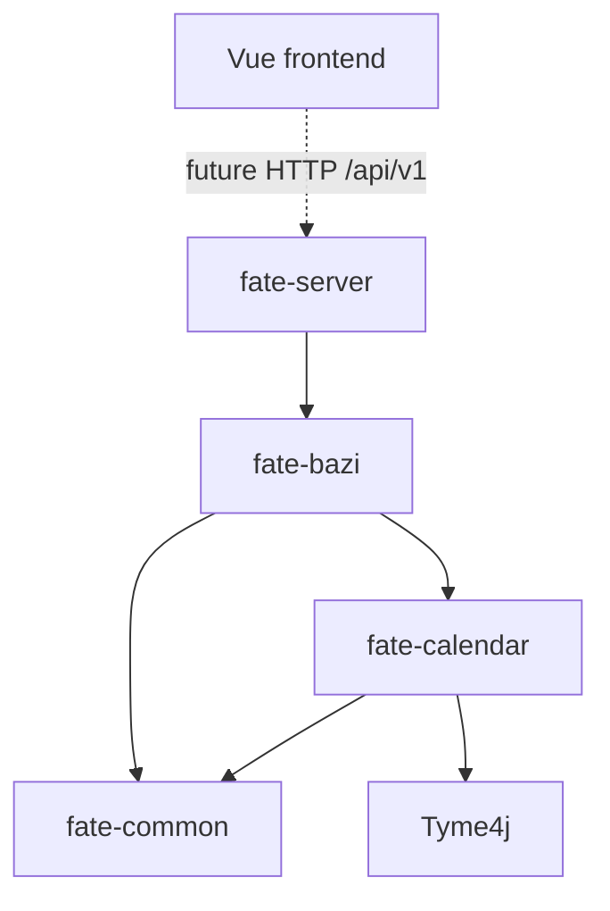

# Architecture / 架构

Monorepo; separate frontend and backend; modular monolith. Core calculation modules have no Spring dependency.

| Module | Responsibility / 职责 |
| --- | --- |
| fate-common | Framework independent shared types / 无框架依赖的公共类型 |
| fate-calendar | Calendar, solar terms, time zones, Gan-Zhi / 历法、节气、时区、干支 |
| fate-bazi | Four pillars, major cycles, annual cycles / 四柱、大运、流年 |
| fate-server | HTTP, validation, security, orchestration / 接口、校验、认证、领域编排 |

`chart`, `auth`, `rule`, `knowledge`, `ai` are reserved domain folders within the server, not implemented features. Organize each future domain into its own API/application/domain/infrastructure boundaries as needed. Do not let core modules depend on the server or persistence.

`chart`、`auth`、`rule`、`knowledge`、`ai` 仅预留目录。后续在领域内按需划分 API、应用、领域和基础设施，计算核心禁止反向依赖服务端或持久化。

Future calculation profiles must preserve original birth input, time zone, location, input precision and calculation strategy. Snapshots should record engine/rule versions for reproducibility. These are design constraints, not database definitions.

未来计算配置需保留出生原始输入、时区、地点、时间精度、计算策略；快照记录算法与规则版本。当前仅记录约束，不定义数据库。

Profiles `local`, `test`, `prod` are planned; only the default profile name is configured. Java 27 remains experimental. AI frameworks, vector databases and rule engines are deferred.

规划 local、test、prod 环境，当前仅设置默认环境名。Java 27 仅作为未来实验验证，暂不引入 AI 框架、向量库和复杂规则引擎。
