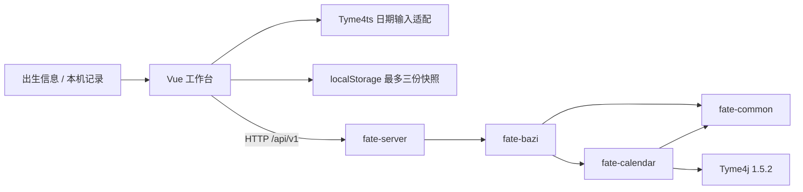
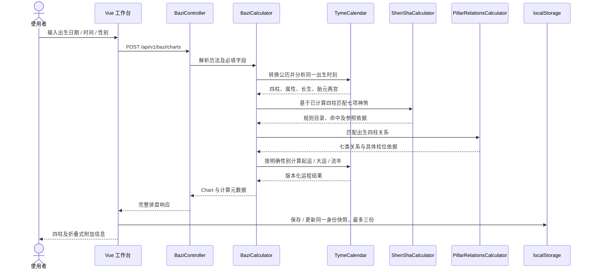

# 系统架构与设计

更新日期：**2026-11-04**。本文说明当前已实现的八字排盘工作台；账号、数据库、云端保存和其他术数单列为后续设计，避免与已有能力混淆。

## 1. 系统形态与职责

当前为前后端分离的模块化单体：Vue 在浏览器处理输入、展示和本机记录，Spring Boot 提供无状态计算接口。默认以本机 Vite + 本机 Java 服务运行，不需要数据库或外部命理服务。

| 模块 | 当前职责 | 边界 |
| --- | --- | --- |
| `fate-common` | 预留公共模块，目前尚无业务类型 | 不引入 Spring / Web / 数据库依赖 |
| `fate-calendar` | 公农历、四柱、十神、藏干、五行、纳音、长生、胎元两宫、起运及运程的 Tyme4j 适配 | 封装外部库 API，不负责 HTTP 或记录存储 |
| `fate-bazi` | 出生范围 / 精度校验、排盘结果编排、8 字五行计数、七项项目神煞规则、运程输入校验 | 不依赖 Spring、服务端或持久化 |
| `fate-server` | Boot 入口、HTTP DTO、输入解析、异常响应、接口安全和健康检查 | 将已校验请求交给领域计算，不在控制器重新实现算法 |
| `frontend` | PC / 手机输入、紧凑命盘、逐级时间选择、本机快照和请求状态 | Tyme4ts 只辅助日期输入；关系和运程取自后端 |

后端坐标为 `dev.fatestay:fate-stay-research:0.1.0-SNAPSHOT`，包前缀 `dev.fatestay.research`。`auth`、`rule`、`knowledge`、`ai` 目录仍是预留边界，不代表已有认证、知识检索或 AI 能力。前端虽声明 Pinia / Vue Router，当前单页主要使用 Vue 响应式状态及组件组合。

## 2. 已完成范围

| 领域 | 已完成内容 | 专题说明 |
| --- | --- | --- |
| 输入与历法 | 公农历 / 闰月、分钟精度、性别、双历输出，PC / 手机选择器 | [日期选择器](../date-time-picker.md) |
| 命盘 | 四柱、日主、十神、藏干、五行、纳音及表层计数 | [API](../api/README.md) |
| 长生与神煞 | 日干长生、自坐长生、七项规则及逐柱命中依据 | [规则查表](../natal-traits.md) |
| 四柱关系 | 五合、六合 / 三合与刑冲破害，准确柱位、刑向和配属五行 | [关系设计](../pillar-relations.md) |
| 衍生宫位 | 胎元、命宫、身宫及其干支属性 | [胎元与两宫](../natal-palaces.md) |
| 起运与运程 | 起运精确时刻 / 间隔、十步大运、流年、流月、流日、流时 | [API](../api/README.md) |
| 工作台 | PC 双栏、手机横向四柱、默认折叠、时间选择面板与单份详情 | [交互设计](../compact-workspace.md) |
| 本机记录 | 最多三份快照、自动保存 / 显式替换、恢复、切换、命名、删除及兼容升级 | [存储设计](../local-chart-library.md) |

## 3. 出生排盘计算链路

`TymeCalendar.analyze` 通过显式 `SolarTime.getSixtyCycleHour().getEightChar()` 获取同一份四柱，统一日干参照，避免修改 `LunarHour` 等全局 provider。`BaziCalculator` 校验转换后的公历范围及分钟精度，并组合结果。集合输出采用不可变集合，领域计算不读写数据库或浏览器状态。

公历和农历请求均落到同一出生时刻；农历闰月通过 Tyme4j 转换。HTTP 新请求明确要求 `MALE/FEMALE`，核心仍保留无性别的旧重载用于兼容四柱计算；该重载不返回起运运程，不擅自猜测性别。

### Chart 结构

| 字段组 | 含义 |
| --- | --- |
| `birthDateTime`、`inputCalendar`、`solarDate`、`lunarDate`、`gender` | 转换后出生时刻、输入历法、双历信息和明确性别 |
| `timeZone`、`precision`、`engineVersion`、`ruleVersion` | 固定偏移、分钟精度、引擎与四柱规则版本 |
| `pillars` | 年 / 月 / 日 / 时干支字符串，保留基础兼容接口 |
| `dayMaster`、`pillarDetails` | 日主、各柱干支 / 藏干十神、五行、纳音、长生和自坐 |
| `elementCounts` | 仅四干四支的五行计数，总数为 8 |
| `shenSha` | 七项项目规则目录及每个柱位的命中依据 |
| `auxiliaryPalaces` | 胎元 / 命宫 / 身宫及其天干十神、五行、纳音 |
| `relations` | 七类出生四柱关系、原生 / 项目来源、参与柱位、形态与刑向 |
| `fortune` | 起运时刻 / 间隔、顺逆方向、十步大运及每步十个流年 |

流月、流日和流时通过独立接口返回，不扩充出生 Chart 快照。详细 DTO 以 [API 文档](../api/README.md) 为准。

## 4. 计算策略与版本

| 结果 | 当前固定口径 / 版本 |
| --- | --- |
| 四柱 | `lichun-jie-zi23-v1`：立春换年、节令换月、23 点换日 |
| 时区与输入 | 固定 `UTC+08:00`、`MINUTE`；公历出生范围 1900–2100 |
| 引擎 | `tyme4j-1.5.2`；Tyme4ts 同为 1.5.2，仅用于输入适配 |
| 起运 | `tyme-default-child-limit-v1`；Tyme4j 默认 ChildLimit，性别与年干阴阳决定顺逆 |
| 运程年龄 | `YEAR_DIFF_PLUS_ONE`，年序虚岁；交运年份结合实际起运 / 交运时刻理解 |
| 流月 / 流日 | `jie-month-zi23-day-v1`；节令区间、23 点日界，含开始、不含结束 |
| 流时 | `zi23-two-hour-jie-clip-v1`；十二标准时辰与所选流日裁切区间相交 |
| 神煞 | `PROJECT_RULES_ON_TYME4J` / `common-seven-day-year-v1` |
| 四柱关系 | `natal-pillar-relations-v1` / `NATAL_FOUR_PILLARS`，Tyme 原生配对与项目规则组合 |
| 胎元两宫 | `tyme-eight-char-palaces-v1`，直接使用原生接口 |

十二长生调用 `HeavenStem.getTerrain`，分别计算日干对各支与各柱自坐。胎元 / 命宫 / 身宫分别调用 `getFetalOrigin/getOwnSign/getBodySign`，不参与四柱数组、8 字五行统计或四柱神煞查柱。

神煞由独立 `ShenShaCalculator` 实现，仅支持已声明的七项：天乙贵人、禄神、驿马、桃花、华盖、将星、旬空。项目规则与 Tyme4j 黄历 `God` 不混用。每个命中记录规则 ID、目标柱位、目标地支和参照依据；同柱同项合并年支 / 日支依据。完整查表及流派约定见 [神煞规则](../natal-traits.md)。

当前无地点、夏令时 / 真太阳时校正或多流派切换；不把胎元视为实际受孕日期，不将五行数量转为旺衰 / 喜用评分。未来新增策略应使用独立版本，不覆盖已有规则含义。

四柱关系在 `BaziCalculator` 中基于已经计算的 `Pillars` 组合，不扩展 `TymeCalendar.Analysis` 或现有四柱规则版本。`TymeRelations` 封装 Tyme4j 的五合、六合、冲、害；`PillarRelationsCalculator` 补充三合、刑、破并保留各柱位组合，匹配集合不可变。前端只渲染和标记，不重复实现关系计算，历史快照缺字段时保留旧结果。详见 [关系规则与边界](../pillar-relations.md)。

## 5. 运程与时间区间

`TymeCalendar.fortune` 使用默认 ChildLimit 输出起运时刻与转换间隔，再得到十步大运。流年干支使用 `SixtyCycleYear`，不误用表示小运的 `Fortune.getSixtyCycle()`。顺排 / 逆排只影响大运方向，流年仍按年份递增。

| 明细 | 计算与边界 |
| --- | --- |
| 流月 | 使用 `SixtyCycleMonth`，由 `SolarTerm` 精确节令时刻形成十二个月；丑月可跨入下一公历年 |
| 流日 | 按 23 点拆分节令月区间，在月首 / 月尾裁切，保留公历日期标签、对应农历和 `partial` 标记 |
| 流时 | 先验证日期属于所选节令流月，再取十二时辰，将每个标准区间与裁切后的流日相交 |

时辰响应同时保留标准起止与实际覆盖；无交集时 `included=false`，实际起止为 `null`。不填造实际覆盖区间，也不把全部十二时辰当作该月的完整时段。流月 / 日 / 时的十神均参照出生时的日干；服务端重新从出生时刻推导，不接受客户端指定日干。查询流年范围为 1900–2210。

## 6. 前端布局与状态

| 组件 / 模块 | 职责 |
| --- | --- |
| `App.vue` | 出生输入、当前命盘、记录库与请求版本；切换输入时失效旧结果，切换快照时恢复输入 |
| `BirthPicker` 与 PC / 手机字段组件 | 按设备载入 Element Plus / Vant；公农历转换、闰月、合法日期及确认操作 |
| `BaziResult` | 四柱横向对照；长生神煞、五行和说明折叠 |
| `PillarRelations` | 默认折叠的关系摘要、分类筛选、柱位 / 干支依据及命盘标记 |
| `AuxiliaryPalaces` | 按需展开胎元 / 命宫 / 身宫属性与计算依据 |
| `LocalChartLibrary` | 记录切换、管理、满额替换、保存状态与存储异常提示 |
| `FortuneResult` | 五级时间入口、当前选择路径、单份所选时间详情及起运摘要 |
| `TimeSelect` | 选择弹窗 / 手机底部面板、关闭行为、焦点返回和背景滚动锁 |
| `use-flow-selection.ts` | 月 / 日 / 时数据、懒加载、下级重置、请求取消和限量缓存 |
| `local-charts.ts` | 快照身份、校验、去重、升级、容量限制及 `LocalStoragePort` |

PC 侧栏放输入和记录，主列放命盘与运程。手机已有记录时默认收起输入和记录列表，四柱仍保持横向对照。服务检查收在次级入口。页面布局和折叠项详见 [工作台设计](../compact-workspace.md)。原先自动纵向展开的 `FlowCalendar/FlowHours` 已由统一选择入口和状态组合函数替代。

### 按需时间状态机

关键约束：

1. 打开命盘、选择流年、选择流月或流日，不自动请求下一级数据；打开对应选择器才加载。
2. 父级实际改变时清空不兼容的下级选择并取消其请求。关闭选择器保留已加载内容，便于重开。
3. 每级使用 AbortController 和响应版本守卫；重试独立，旧响应不能覆盖新上下文。
4. 月、日、时各缓存最多 24 份响应；缓存键包含出生时刻、流年及必要的月 / 日上级值。缓存随组件上下文销毁，不写入 localStorage。
5. 当前页面只展示一份时间详情；已选路径可回看上级，精确区间 / 截断说明默认折叠。

## 7. 本机快照与兼容

持久化边界目前仅为浏览器 `localStorage`，存储键 `fatestay.guest-charts.v1`，数据结构为 `{version:1, records, activeId}`。记录含 `id/name/birth/chart/savedAt`，最多三份。

- 身份为转换后的公历出生分钟 + 性别；等价公农历输入更新同一记录，不增加位置。不同性别分别占位。
- 成功计算自动保存；满额时不自动淘汰，由用户选择替换或暂不保存。
- 切换 / 刷新恢复已保存的完整快照，不请求重算；修改出生信息使旧结果失效，避免误存到其他出生时刻。
- 旧的无性别 / 无新字段快照继续可读。明确补充性别并重算时升级旧位置；新增长生、神煞、宫位字段存在时校验完整性，损坏记录跳过。
- 存储禁止 / 配额不足时退化为当前页面内使用，并提示刷新可能不保留；不静默上传历史数据。

已加载页面内切换快照可不依赖网络，但不等于离线启动网站或浏览器独立排盘。换浏览器、清除站点数据或改变来源不会共享缓存。未来账号存储应通过适配层接入，并明确迁移与用户选择；当前尚无后端记录接口。细节见 [本机记录设计](../local-chart-library.md)。

## 8. HTTP、安全与运行环境

公开路径仅包括两个健康接口，以及四个精确的 `POST /api/v1/bazi/{charts,flow-months,flow-days,flow-hours}` 计算接口。四条计算路径单独豁免 CSRF，其他路径默认拒绝。当前没有账号认证、登录态或用户授权模型，不能把 Spring Security 依赖视为已有账户功能。

Springdoc 已声明，但 OpenAPI / Swagger 路径尚未放行。HTTP 输入负责必填、类型和历法解析，领域层继续校验范围、分钟精度和时间层级归属。错误输入返回中文 400，控制器不存储计算请求。

Vite 在 `127.0.0.1:5173` 代理 `/api` 到本地 8080。后端默认 `local` 环境已通过 `application-local.yml` 排除数据源自动配置，即便启用 Maven `persistence` 依赖也不会连接数据库。`test/prod` 专用运行配置、数据库结构、迁移、容器和生产反向代理仍未实现。`npm run preview` 仅为静态预览。

JDK / Node 环境、启动 / 停止命令见 [macOS 开发](../local-development-macos.md)，生产接入边界见 [部署说明](../../deploy/README.md)。

## 9. 验证现状

最近一次功能验证：152 项核心计算 + 54 项 HTTP / 安全测试、前端 25 项日期 / 缓存测试、TypeScript / Vite 构建均通过。覆盖已知样例、公农历 / 闰月等价性、性别、节令 / 时辰边界、支持范围及版本化附加字段。

桌面 / 390px / 320px 的临时 Playwright 验证覆盖：默认无流月以下请求、逐级打开才加载、缓存复用、失败重试、延迟旧响应、Esc / 遮罩关闭、焦点 / 滚动恢复、记录管理及真实日期输入。浏览器脚本未纳入 CI，Safari / Android 真机尚未覆盖。CI 当前执行 Maven 默认 / 可选持久化构建及前端依赖检查、测试和构建。

这些是现有验证结果，不表示未来代码修改后的自动保证。分阶段证据和边界见 [验证记录](../verification.md)。

## 10. 后续设计方向

| 方向 | 需要明确的设计 |
| --- | --- |
| 账号与持久化 | 数据库版本、账号 / 排盘模型、认证、隔离、迁移及浏览器快照导入流程 |
| 多计算策略 | 原始输入、时区 / 地点、校正方式、策略标识、版本与可复现结果 |
| 部署与接口说明 | 生产配置、反向代理、开放 API 文档、安全边界和跨浏览器验证 |
| 更多研究能力 | 紫微斗数、古籍、知识检索与 AI 的独立模块边界 |

维持计算核心独立于 Web / 存储的依赖方向。后续按领域需求再拆分 API、应用、领域和基础设施，不提前引入数据库容器、向量库、AI 框架或复杂规则引擎。
