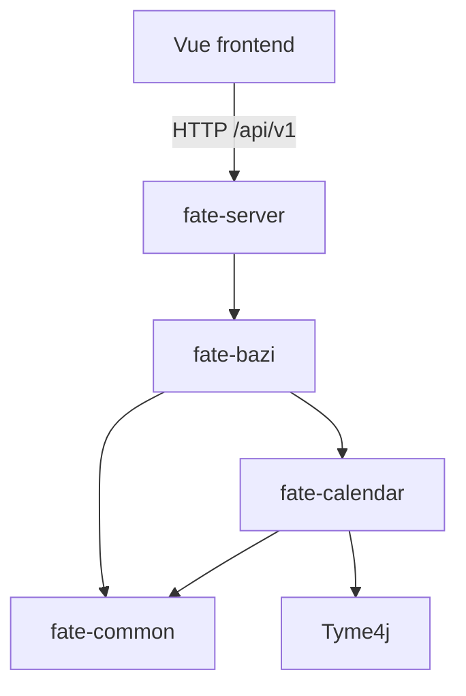

# Architecture / 架构

Monorepo; separate frontend and backend; modular monolith. Core calculation modules have no Spring dependency.

| Module | Responsibility / 职责 |
| --- | --- |
| fate-common | Framework independent shared types / 无框架依赖的公共类型 |
| fate-calendar | Calendar, solar terms, time zones, Gan-Zhi / 历法、节气、时区、干支 |
| fate-bazi | Four pillars, major cycles, annual cycles / 四柱、大运、流年 |
| fate-server | HTTP, validation, security, orchestration / 接口、校验、认证、领域编排 |

`chart` now provides the minimum four-pillars endpoint; `auth`, `rule`, `knowledge`, `ai` remain reserved folders. Organize each future domain into its own API/application/domain/infrastructure boundaries as needed. Do not let core modules depend on the server or persistence.

`chart` 已提供最小四柱接口，其余 `auth`、`rule`、`knowledge`、`ai` 仅预留目录。后续在领域内按需划分 API、应用、领域和基础设施，计算核心禁止反向依赖服务端或持久化。

Future calculation profiles must preserve original birth input, time zone, location, input precision and calculation strategy. Snapshots should record engine/rule versions for reproducibility. These are design constraints, not database definitions.

未来计算配置需保留出生原始输入、时区、地点、时间精度、计算策略；快照记录算法与规则版本。当前仅记录约束，不定义数据库。

Profiles `local`, `test`, `prod` are planned; only the default profile name is configured. Java 27 remains experimental. AI frameworks, vector databases and rule engines are deferred.

规划 local、test、prod 环境，当前仅设置默认环境名。Java 27 仅作为未来实验验证，暂不引入 AI 框架、向量库和复杂规则引擎。

## Current four-pillars flow

`BaziController` validates request input → framework-independent `BaziCalculator` checks range/precision and records policy metadata → `TymeCalendar` adapts the pinned Tyme4j API. The adapter uses explicit SixtyCycle rules instead of changing a global LunarHour provider. No database or framework dependency is added to the calculation modules.

`TymeCalendar.analyze` uses the same EightChar instance for pillar details and the day-stem reference. `BaziCalculator` aggregates eight-character element counts with immutable output collections. Existing pillar strings remain available for compatibility; the UI renders enrichment from the backend rather than recalculating relationships in JavaScript.

Guest chart snapshots are stored only in browser localStorage through `LocalStoragePort`. Record identity uses the fixed-offset solar minute, deduplicating equivalent solar/lunar input. No backend persistence/authentication boundary is introduced. See [local library](../local-chart-library.md).

`TymeCalendar.fortune` adapts the default ChildLimit provider into immutable start-time/interval, decade and annual-year records. Annual Gan-Zhi uses SixtyCycleYear rather than the minor-fortune Fortune class. Public HTTP requests require explicit gender; legacy core overloads remain four-pillars-only for compatibility.
